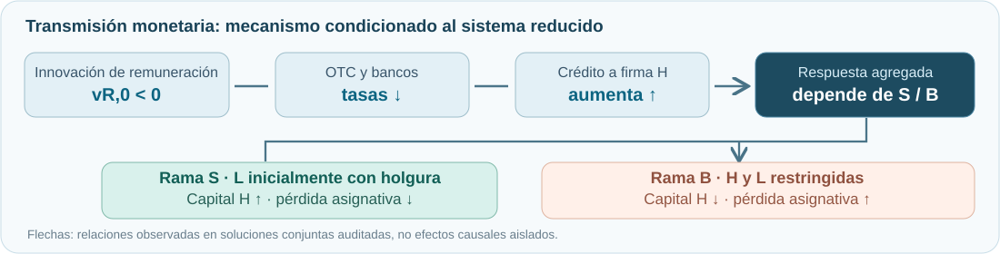
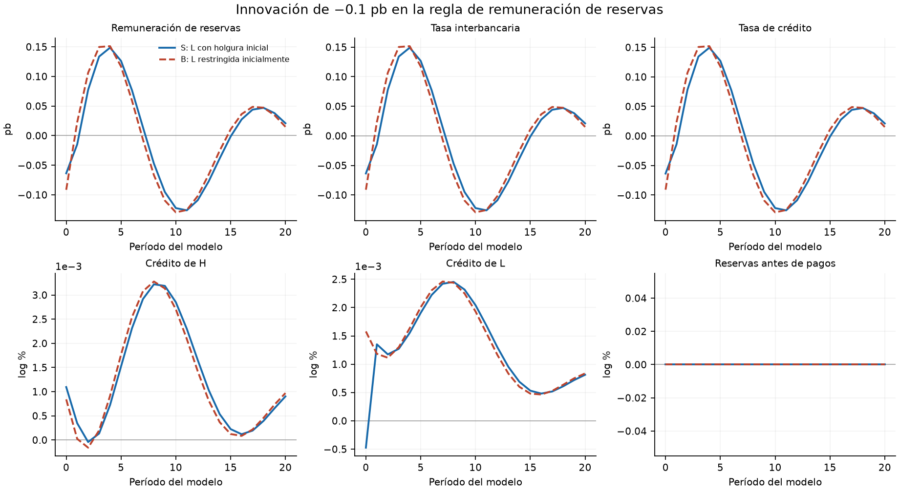
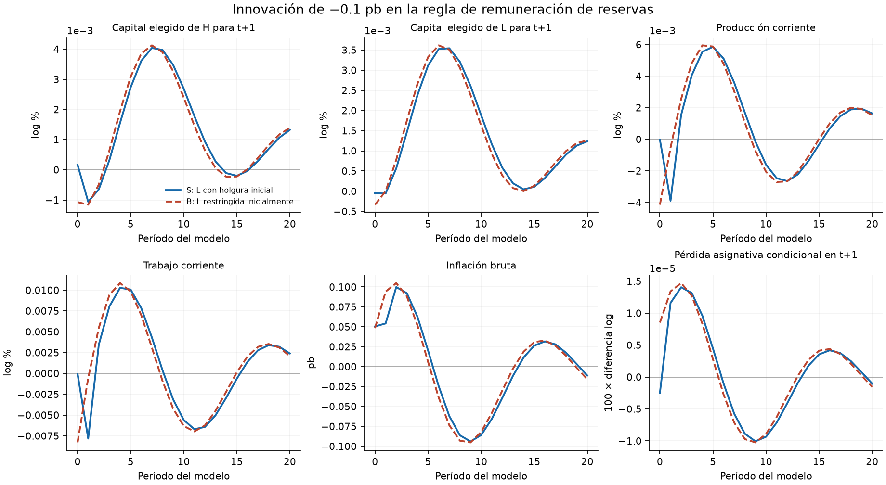

<p align="center">
  
</p>

<p align="center">
  <a href="paper/paper.pdf"></a>
  <a href="slides/final.pdf"></a>
  <a href="code/irf/README.md"></a>
  <a href="lean/README.md"></a>
</p>

<p align="center">
  <a href="https://github.com/alejandroventuraventurameza-tech/ai-project/actions/workflows/build.yml"></a>
  
  
  <a href="https://github.com/alejandroventuraventurameza-tech/ai-project/actions/runs/42397125883"></a>
</p>

<p align="center">
  <strong>Alejandro Ventura</strong><br>
  Profesor Alexander Quispe · Universidad del Pacífico<br>
  <sub>AI and Economic Modeling · Track B · 2026-II · <a href="https://github.com/alexanderquispe/AI-Econ-Modeling/issues/7">Consigna oficial</a></sub>
</p>

---

> **Pregunta** · ¿Cuándo una reducción de la remuneración de reservas, transmitida por el mercado interbancario y los bancos comerciales, mejora la asignación de capital entre empresas heterogéneas y cuándo puede empeorarla?

## 01 · Modelo y experimento

Economía neokeynesiana cerrada con firmas **H** (más productiva) y **L**, bancos comerciales con pagos idiosincráticos, negociación OTC, hogares y un banco central. Cada empresario elige consumo, inversión y financiamiento bajo presupuesto y una **restricción de colateral robusto**:

```math
c_{i,t}+q_t k_{i,t+1}+a_{i,t}=N_{i,t}+b_{i,t},
\qquad
R_t^L b_{i,t}\leq \Gamma_{i,t+1} k_{i,t+1}.
```

**Shock:** innovación inicial `v_{R,0}=-10^{-5}` (aproximadamente **−0,1 pb**) en la regla de remuneración de reservas. El coeficiente de encaje queda **fijo** en `ρ=0,10`; los futuros shocks agregados se mantienen nulos. Se comparan las mismas posiciones heredadas, con pagos `ω=±0,2` equiprobables y parámetros ilustrativos — **no estimados para Perú**.

## 02 · Resultado condicional: dos ramas

<p align="center"></p>

El **sistema reducido local de 33 ecuaciones** tiene un prefijo no lineal de dos fechas y una continuación local recurrente. La firma H está restringida en ambas ramas; **L tiene holgura inicial en S** y **ambas firmas están restringidas en B**. No se impone una regla de selección.

| Respuesta al impacto | Rama **S** | Rama **B** |
|:--|--:|--:|
| Tasa de crédito (pb) | −0,063632 | −0,090908 |
| Crédito a H (log %) | +0,001095 | +0,000841 |
| Capital elegido por H (log %) | +0,000164 | −0,001073 |
| Producción corriente (log %) | −0,000036 | −0,004143 |
| Pérdida asignativa condicional (100 Δlog) | −0,00000248 | +0,00000852 |

<p align="center">
  
  
</p>

<sub>Figuras generadas por `code/irf/reproduce.py`, no curvas ilustrativas. Tasas por período sin anualizar. El capital elegido en t se instala en t+1; la pérdida asignativa usa producción futura y **no es bienestar**.</sub>

## 03 · Qué está verificado

Se comprueban residuos, márgenes de régimen, KKT necesarias y liquidación bancaria en ambas ramas. La robustez se compara con soluciones reducidas **no lineales finitas hasta T=640**. En S aumenta el capital elegido por H y disminuye la pérdida asignativa; en B ocurre lo contrario, aunque su crédito también aumenta.

**Límite:** no se ha demostrado que estas IRF sean equilibrios competitivos infinitos ni una respuesta empírica causal. La auditoría Lean más reciente verifica lemas y correspondencias condicionadas de ocho filas del operador aumentado, además de una compatibilidad estacionaria; **no** equivale a formalizar exactamente los **57 resultados inventariados en el paper**, ni las 34 derivadas del evaluador numérico.

## 04 · Archivos y reproducción

| Entregable | Acceso | Estado |
|:--|:--|:--|
| **Paper** | [PDF](paper/paper.pdf) · [LaTeX](paper/paper.tex) · [Referencias](paper/references.bib) | **Cuerpo compacto de 9 páginas**, verificado por CI; dossier técnico extenso conservado en anexo, revisión científica pendiente |
| **Presentación final** | [PDF](slides/final.pdf) · [Fuente](slides/final.tex) · [Guion formal](slides/GUIA_EXPOSICION_FORMAL.md) | Comparación literal paper–Lean y prueba de alcance añadidas; última compilación y manuscrito del autor pendientes |
| **IRF y código** | [Reproducción](code/irf/README.md) · [Entrada única](code/verify.py) · [Auditoría](code/irf/output/delivery_audit.json) | Verificaciones internas aprobadas |
| **Lean** | [Código](lean/README.md) · [Auditoría](https://github.com/alejandroventuraventurameza-tech/ai-project/actions/runs/42454446386) | Candidatos compilados y axiomas auditados en módulos escogidos; mapa exacto de los 57 resultados pendiente |
| **Derivaciones a mano** | [hand/](hand/README.md) · [Guía detallada](hand/GUIA_DERIVACION_MANUSCRITA_NUCLEO.md) | Guía tipografiada; escaneos y juicio personal del autor **pendientes** |
| **Material de tema** | [Propuesta](proposal/proposal.pdf) · [Slides](slides/topic.pdf) | Conservados |
| **Colaboración con IA** | [Prompts](prompts.md) · [Informe de cierre](AUDITORIA_CIERRE_2026-11-07.md) | Registro y límites documentados |

```bash
python -m pip install -r code/requirements.txt
python code/verify.py
```

<sub>**Entrega final: 26 de noviembre de 2026 a las 22:00 (Lima)**. Se califica el contenido integrado en `main`, no únicamente las ramas. Seguir el flujo rama → pull request → merge y las [instrucciones oficiales](https://github.com/alexanderquispe/AI-Econ-Modeling/issues/7).</sub>
